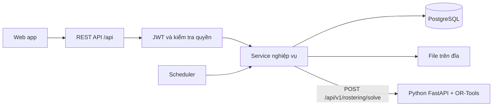
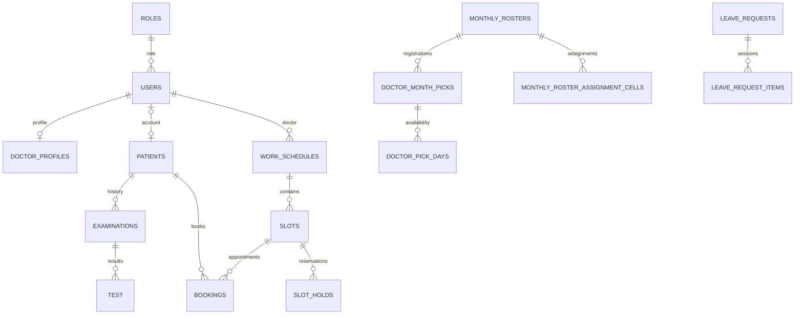

# Backend ABClinic và bản thiết kế chuyển sang Go — không gồm AI

Ngày khảo sát: 10/11/2026. Nguồn: mã trong workspace hiện tại, gồm cả thay đổi chưa commit. Đây là phân tích tĩnh, chưa xác minh với database hoặc API đang chạy. Không thay đổi mã ứng dụng, không xoá module AI.

## 1. Hệ thống hiện tại

Backend chính là một monolith Java 21, Spring Boot 3.5.10, Maven. HTTP REST dùng Spring MVC; dữ liệu dùng Spring Data JPA/Hibernate và PostgreSQL; xác thực Spring Security + JWT HS256; mật khẩu BCrypt cost 10. Có Bean Validation, MapStruct, OpenAPI/Swagger, Apache POI để đọc Excel, lưu file trên đĩa.

- Mã backend: `backend/src/main/java/com/abclinic/backend/`.
- Cấu hình: `backend/src/main/resources/application.yaml`.
- Cổng mặc định: `8081`; tiền tố API: `/api`.
- Swagger: `/api/swagger-ui.html`; schema: `/api/v3/api-docs` khi backend chạy.
- Schema hiện được Hibernate `ddl-auto: update` cập nhật. Các SQL ở `resources/db/manual/` là script thủ công; không thấy Flyway/Liquibase trong `pom.xml`.
- `docker-compose.yml` ở gốc chạy PostgreSQL 16, backend, frontend, solver Python và các job seed. PostgreSQL được map ra cổng host 5433; cấu hình chạy backend ngoài Docker mặc định DB_PORT 5435. Cần phân biệt hai cách chạy.
- Luồng được khảo sát dùng PostgreSQL để lưu hold, hàng đợi và notification; không cần thêm Redis hoặc message broker để mô tả lại các luồng này.



OR-Tools là bộ giải bài toán tối ưu lịch với các ràng buộc, độc lập với các module AI/LLM của dự án. Có thể giữ solver Python và viết lại backend nghiệp vụ bằng Go. Nếu muốn bỏ cả Python, bạn phải thực hiện thêm một bài toán thay thế solver; đó là phần riêng của việc chuyển đổi.

## 2. Cấu trúc mã Java

```text
com/abclinic/backend/
├── controller/          HTTP route, request/response, lấy user hiện tại
├── dto/request/         DTO đầu vào, validation
├── dto/response/        DTO đầu ra, wrapper, pagination
├── service/             Interface nghiệp vụ
│   ├── impl/            Triển khai nghiệp vụ, transaction và phân quyền
│   ├── booking/         Cấu hình hàng đợi
│   ├── roster/          Chính sách thời gian, đăng ký, sinh lịch và slot
│   └── rostering/       HTTP client và DTO gọi solver Python
├── repository/          Truy vấn JPA và SQL cập nhật nguyên tử
├── model/entity/        Bảng, cột, quan hệ, default, lifecycle
├── model/enums/         Trạng thái nghiệp vụ
├── mapper/              Chuyển entity thành DTO
├── configuration/       Security, CORS, JSON, HTTP client, Clock
├── exception/           Mã lỗi và ánh xạ HTTP
└── scheduler/           Job định kỳ
```

Luồng thông thường: `Controller → ServiceImpl → Repository → PostgreSQL → DTO`. Phân quyền có nhiều chỗ đặt trên service bằng `@PreAuthorize`, không chỉ ở controller; đọc controller đơn lẻ sẽ thiếu quyền của endpoint.

## 3. Các module nghiệp vụ đã có

| Module | Chức năng hiện có | Điểm đọc mã chính |
|---|---|---|
| Auth | Đăng ký, đăng ký bệnh nhân, đăng nhập, refresh token, logout | `AuthServiceImpl`, `JwtServiceImpl`, `SecurityConfig` |
| Quản trị tài khoản | Danh sách/tìm kiếm/phân trang, tạo/sửa user, đổi trạng thái, đặt lại mật khẩu, danh sách role | `AdminUserServiceImpl` |
| Hồ sơ bác sĩ | Gán hồ sơ cho user, danh sách bác sĩ hoạt động, số bệnh nhân/giờ, thời lượng khám | `DoctorProfileServiceImpl` |
| Bệnh nhân | Tạo/sửa/chi tiết/danh sách, tìm kiếm, lọc ngày, thống kê, bệnh sử, tiền sử gia đình, thuốc đang ghi nhận, import | `PatientServiceImpl` |
| Thuốc | CRUD, lọc/phân trang, metadata, nhập hàng loạt, thành phần và hướng dẫn | `MedicineServiceImpl`, `MedicineSpecification` |
| Kết quả khám | Tạo/sửa kết quả khám, lấy theo bệnh nhân hoặc ID, lưu kết quả xét nghiệm | `ExaminationServiceImpl` |
| Đăng ký lịch bác sĩ | Khả năng làm việc OFF/OK/PREF theo ngày và buổi; đăng ký một hoặc nhiều tháng | `DoctorMonthPickServiceImpl` |
| Xếp lịch tháng | Mở kỳ, cấu hình, chạy solver, sửa/khóa phân công, duyệt, công bố, audit | `MonthlyRosterServiceImpl` |
| Lịch đã công bố | Danh sách ca, lịch cá nhân, xem tác động, thay/rút bác sĩ | `WorkScheduleGenerator`, `PublishedRosterSwapServiceImpl` |
| Xin nghỉ | Tạo đơn nhiều ô ngày/buổi, xem tác động, chọn người thay, duyệt/từ chối/thu hồi | `LeaveRequestServiceImpl` |
| Phòng khám nghỉ | Khai báo cả ngày hoặc một buổi, khai báo hàng loạt, xem booking bị ảnh hưởng, hủy khai báo | `ClinicClosureServiceImpl` |
| Đặt khám | Xem chỗ trống, giữ/nhả chỗ, tự đặt, lễ tân đặt hộ, hủy, đổi bác sĩ, đổi giờ | `BookingServiceImpl` |
| Hàng đợi khám | Check-in/hoàn tác, trễ/không đến, gọi khám, gọi không được, đổi chỗ, kết thúc khám | `BookingServiceImpl` |
| Thông báo | Lưu thông báo theo người nhận, danh sách của tôi, đánh dấu đã đọc | `NotificationServiceImpl` |
| File | Upload multipart, lưu metadata, liệt kê theo bệnh nhân/phiên | `FileServiceImpl` — cần tách khỏi AiSession |

Thuốc có các trường tồn kho, giá nhập/bán, hạn dùng, vị trí tủ/kệ, nhưng các API được khảo sát là quản lý danh mục và import. Không coi chúng là một hệ thống hoàn chỉnh về hóa đơn, thanh toán hay sổ giao dịch nhập/xuất kho.

## 4. Mô hình dữ liệu cần mang sang Go

| Nhóm | Bảng chính | Quan hệ/lưu ý |
|---|---|---|
| Tài khoản | `roles`, `users`, `invalidated_token` | Một user tham chiếu một role; token thu hồi lưu theo jti |
| Bác sĩ | `doctor_profiles` | Một hồ sơ ứng với một user; user_id unique |
| Bệnh nhân | `patients`, `patient_profiles`, `medical_histories`, `family_histories`, `patient_medicines` | Patient có thể không có user; user_id nullable và unique |
| Thuốc | `medicines`, `ingredients`, `medicine_descriptions`, `medicine_usage_notes` | Mã thuốc unique; mô tả 1–1; usage notes là collection table |
| Khám | `examinations`, `test` | Một lần khám có nhiều kết quả xét nghiệm; bảng tên `test` |
| Cấu hình lịch | `clinic_schedule_configs`, `clinic_schedule_config_logs` | Cấu hình solver chung, log thay đổi |
| Kỳ đăng ký | `monthly_rosters`, `doctor_month_picks`, `doctor_pick_days`, `doctor_planned_days` | Kỳ tháng → đăng ký mỗi bác sĩ → ô ngày/buổi; planned days cho tháng tương lai |
| Kết quả xếp lịch | `monthly_roster_assignment_cells`, `monthly_roster_audit_logs` | Phân công và khóa ô, nguồn phân công, audit |
| Lịch khám thực tế | `work_schedules`, `slots` | Một ca bác sĩ có nhiều slot; slot có capacity, booked_count |
| Đặt khám | `bookings`, `slot_holds`, `booking_swap_logs`, `booking_call_logs` | Booking → Patient và Slot; lưu slot gốc và lịch sử gọi/đổi |
| Nghỉ phép | `leave_requests`, `leave_request_items` | Một đơn có nhiều ngày/buổi, người thay đề xuất/được duyệt |
| Phòng khám nghỉ | `clinic_closures`, `clinic_closure_logs` | Unique ngày + loại buổi nghỉ |
| Thông báo | `notifications` | Người nhận là user, có thể liên kết booking |
| File | `file_attachments` | Hiện tham chiếu AiSession; thiết kế lại nếu bỏ AI |



Đây là sơ đồ quan hệ cốt lõi, không phải toàn bộ DDL. Entity là nguồn tham khảo cột; schema DB thực tế cần kiểm tra riêng vì dự án có script SQL sửa dữ liệu/constraint cũ.

### Kiểu dữ liệu và constraint

- User ID: UUID được Java biểu diễn bằng String. Patient ID: chuỗi nghiệp vụ kiểu `BN-XXXXXXXX`, không ép thành UUID. Phần lớn các ID còn lại là Long/identity.
- Tiền thuốc là `BigDecimal` và `NUMERIC` trong DB: giữ độ chính xác thập phân, không dùng float64 cho tính tiền.
- Ngày làm việc/ngày sinh dùng date; giờ ca dùng time; nhiều timestamp Java là LocalDateTime. Giữ quy ước `Asia/Ho_Chi_Minh` và quyết định rõ khi nào JSON có timezone.
- Giữ null đúng ý nghĩa: bệnh nhân không có account; booking tự đặt không có created_by; chưa check-in chưa có checked_in_at.
- Unique cần giữ: doctor profile/user; month pick/(roster, doctor); pick day/(pick, date, session); assignment/(roster, doctor, date, session); hold/(slot, patient).
- Không trả thẳng model DB ra JSON. Go DTO cần giữ tên camelCase như frontend đang dùng.

## 5. Luồng nghiệp vụ quan trọng

### A. Tài khoản và JWT

1. Login bằng email và mật khẩu; kiểm tra BCrypt và isActive.
2. Access JWT: HS256, sub=user ID, iss=`abclinic-backend`, iat, exp, jti, email, scope dạng `ROLE_DOCTOR`.
3. Refresh JWT dùng khóa riêng và có sub/iss/iat/exp/jti.
4. Mỗi lần xác minh còn tra token bị thu hồi và user còn hoạt động; đây không phải cơ chế JWT chỉ xác minh chữ ký.
5. Logout thu hồi cả hai token còn hạn. Refresh thu hồi refresh token cũ và cấp cặp mới.
6. Đăng ký bệnh nhân tạo role PATIENT, rồi liên kết hồ sơ đã có theo số điện thoại hoặc tạo mới. Patient và User là hai thực thể khác nhau.

Các role trong luồng hiện tại: ADMIN, MANAGER, DOCTOR, RECEPTIONIST, PATIENT. ADMIN không tự động được gọi mọi API nghiệp vụ: hasRole được kiểm tra cụ thể ở từng service.

### B. Từ đăng ký tháng đến slot đặt khám

1. Manager mở kỳ hoặc scheduler tự mở. Snapshot thời điểm mở đăng ký, khóa đăng ký, hạn công bố vào kỳ.
2. Bác sĩ nộp OFF/OK/PREF theo ngày/buổi và số bệnh nhân/giờ, có thể áp dụng nhiều tháng. Số bệnh nhân/giờ phải nằm trong trung bình cấu hình ±1.
3. Tháng chưa mở thì kế hoạch tương lai nằm ở doctor_planned_days. Khi mở kỳ, kế hoạch được áp dụng; đăng ký dài hạn tạo ưu tiên mềm trong solver.
4. Manager chạy solver: đọc đăng ký, ngày nghỉ, khóa phân công và cấu hình; gọi Python; lưu kết quả/metrics/thiếu người. Kỳ có các trạng thái PENDING → DRAFT → APPROVED → PUBLISHED. Khi chạy trước hạn và không đóng đăng ký sớm, có thể chỉ xem trước kết quả và kỳ vẫn PENDING; không phải mọi lần solve đều chuyển DRAFT. Có API quay về draft trước công bố và publish-now.
5. Có thể thêm/bớt phân công, khóa một bác sĩ hoặc đóng băng cả buổi. Chạy solver lại phải giữ các quyết định khóa phù hợp.
6. Công bố mới sinh WorkSchedule và Slot để bệnh nhân đặt; không đặt trực tiếp vào assignment của solver.
7. Buổi sáng 06:30–11:30, chiều 13:00–18:00. Generator hiện sinh 5 slot một giờ mỗi buổi, bufferMinutes=0. Có hằng BUFFER_MINUTES=5 ở file constants nhưng generator không dùng nó.
8. Capacity slot lấy patientsPerHour đã đăng ký đúng tháng, fallback về hồ sơ bác sĩ với dữ liệu cũ. Sửa hồ sơ sau không làm đổi capacity của slot đã tồn tại.
9. Generator kiểm tra ca đã có; ca bị CANCELLED có thể được kích hoạt lại, tránh nhân đôi khi đổi bác sĩ qua lại.

Solver phạt thiếu người theo ràng buộc mềm, thưởng nguyện vọng/đăng ký dài hạn và cân bằng tải. Vì vậy có lời giải không đồng nghĩa mọi buổi đủ người. Giữ shortfalls và cơ chế xác nhận cảnh báo khi duyệt/công bố.

### C. Đặt khám và giữ chỗ

1. Lấy lịch/slot phù hợp; loại lịch không còn được đặt, nghỉ phòng khám và nghỉ đã duyệt theo logic service.
2. Bệnh nhân có thể hold một chỗ 10 phút. Hold riêng theo (slot, patient), không khóa toàn bộ slot nhiều chỗ.
3. Khi xác nhận, kiểm tra slot đã qua, đóng cửa, trùng lịch người được đặt và chỗ trống; nhận chỗ rồi tạo booking trong cùng transaction. Xóa hold của người đặt, thông báo bác sĩ.
4. Số chỗ khả dụng dùng capacity − booked_count − hold còn hạn của người khác. Hold hiện là thao tác đọc rồi ghi; không coi đó là cơ chế khóa độc quyền tuyệt đối khi có nhiều request đồng thời.
5. Nhận chỗ dùng UPDATE có điều kiện `booked_count < capacity`, kiểm tra affected rows; nhả chỗ cũng là UPDATE nguyên tử. Phải giữ tính chất này trong Go.
6. Lễ tân có thể đặt vượt sức chứa khi request có allowOverCapacity. Không được đưa constraint `booked_count <= capacity` một cách máy móc vì sẽ chặn nghiệp vụ này.
7. Có đặt cho người thân bằng tên/quan hệ trên booking, không tạo Patient con riêng.
8. Đổi bác sĩ và đổi lịch có xử lý booking cũ/mới, nhả/nhận chỗ và thông báo. Đọc `doSwitchDoctor`/`doReschedule` khi port, không chỉ đổi slot_id.

### D. Hàng đợi tại phòng khám

```text
BOOKED ──check-in──> CHECKED_IN ──call──> CALLED ──finish──> COMPLETED
   └──quá ngưỡng──> LATE ──check-in──> CHECKED_IN
BOOKED/LATE ──hết ca mà chưa đến──> NO_SHOW
```

Sơ đồ trên là luồng chính; API còn có hủy, hoàn tác check-in, gọi không được và finish trực tiếp từ CHECKED_IN.

- Có queue_slot_start/queue_order_at/checked_in_late để giữ thứ tự qua các lần đổi chỗ và gọi thất bại. Không chỉ sort theo thời gian tạo booking.
- Mục tiêu nghiệp vụ: mỗi WorkSchedule có tối đa một bệnh nhân CALLED. Code hiện kiểm tra trước khi cập nhật; khi port cần đảm bảo điều kiện đó cả dưới concurrency.
- Người check-in muộn được xếp cuối hàng chờ. Ngưỡng late-after lấy config; YAML hiện mặc định 1 phút dù một số comment còn ghi 10 phút.
- Gọi người của slot sau lên sớm chỉ được khi đủ điều kiện; nếu slot hiện tại còn người trễ thì phải dùng luồng đổi chỗ.
- Đổi chỗ/gọi vượt slot cần cập nhật slot gốc, số chỗ, thứ tự và log liên quan.
- Bác sĩ kết thúc khám chỉ cho booking thuộc ca của mình; lễ tân có thể xác nhận hộ.

### E. Thay đổi sau công bố, xin nghỉ và đóng cửa

- Đổi/rút bác sĩ: tính tác động; khóa dòng kỳ; cập nhật assignment; hủy hiệu lực WorkSchedule cũ và tạo/kích hoạt ca mới nếu có bác sĩ thay; gửi thông báo. Booking cũ còn tham chiếu ca cũ để giữ lịch sử và phục vụ xử lý tiếp, không mặc định tự chuyển toàn bộ sang bác sĩ mới.
- Không xóa WorkSchedule/Slot đã có booking. Bác sĩ/ngày/giờ của booking được suy ra qua `Booking → Slot → WorkSchedule`.
- Xin nghỉ: đơn gồm nhiều ngày/buổi, có người thay cho từng ô. Manager phải xác nhận thông báo nếu tác động booking của lịch đã publish. Khi duyệt phải kiểm tra lại người thay còn rảnh và áp dụng vào roster tương ứng.
- Nghỉ phòng khám: xem tác động, xác nhận hủy booking nếu cần, ghi closure/log, hủy các booking BOOKED bị ảnh hưởng, nhả chỗ và gửi thông báo. Code hiện lọc BOOKED; không tự suy rộng thành hủy tất cả trạng thái.
- Trạng thái đơn nghỉ: PENDING/APPROVED/REJECTED/WITHDRAWN. Bác sĩ chỉ thu hồi đơn còn chờ.

## 6. Job nền cần viết lại

| Job Java | Nhịp hiện tại | Nhiệm vụ |
|---|---|---|
| SlotHoldCleanupScheduler | Mỗi phút, giây 0 | Xóa hold hết hạn; nhả cả trạng thái hold kiểu cũ trên Slot |
| BookingQueueScheduler | Mỗi phút, giây 30 | Đánh dấu LATE, chuyển NO_SHOW khi hết ca; không tự đổi chỗ |
| MonthlyRosterScheduler | Mỗi 5 phút | Mở kỳ cần thiết, khóa đăng ký quá hạn, báo hết hạn mở lại, nhắc công bố sau 08:00 một lần/ngày |
| TokenCleanupScheduler | Hàng ngày 00:00 | Xóa token thu hồi đã hết hạn |

Nếu chạy nhiều instance Go, thiết kế job một lần bằng worker duy nhất hoặc khóa DB; cờ chống trùng logic chưa thay thế hoàn toàn khóa giữa nhiều tiến trình. Inject clock vào nghiệp vụ thời gian để kiểm thử.

## 7. Bỏ AI: phạm vi và những chỗ phải tách

Không mang các thư mục `AI-Module/`, `ai-service/`, các service ai/safety, AiSession/OCR/Task controller và internal API phục vụ AI vào backend Go cốt lõi.

Tuy nhiên, không thể chỉ bỏ tên file có chữ AI:

| Chỗ hiện bị ghép với AI | Xử lý trong bản Go không AI |
|---|---|
| ExaminationServiceImpl gọi Gemini khi tạo/sửa kết quả nhập tay | Giữ lưu khám/xét nghiệm, bỏ bước gọi safety provider |
| FileAttach.session → AiSession; list file bệnh nhân đi qua session.patient | Thiết kế file gắn trực tiếp patient_id, examination_id tùy chọn; migrate liên kết hiện có trước khi bỏ session |
| Patient summary và summary-history đọc Prescription/Otc/Risk/Plan/FinalRecord | Chỉ giữ dữ liệu nghiệp vụ được xác định; thiết kế lại summary không cần AiSession |
| Import bệnh nhân có nhánh supplementPlan tạo AiSession/FinalRecord giả để lưu kế hoạch | Tách import hồ sơ/lần khám khỏi nhánh lưu kết quả AI; không bê nguyên service sang Go |
| Đơn thuốc/kế hoạch hiện liên kết FinalRecord | Nếu vẫn cần kê đơn thủ công, thiết kế module riêng gắn với lần khám và migrate dữ liệu; không khẳng định đã có CRUD kê đơn độc lập đầy đủ |
| application.yaml, ApplicationConfig, GlobalExceptionHandler còn cấu hình/type AI | Bỏ cấu hình và exception AI; HTTP client solver có timeout riêng |

Nếu chỉ bỏ chức năng AI nhưng cần giữ dữ liệu đơn thuốc/kế hoạch cũ, chưa được xóa các bảng liên quan trước khi có migration thay thế. Tài liệu này không thực hiện việc xóa đó.

## 8. Cấu trúc Go đề xuất

Một ứng dụng Go chia module theo nghiệp vụ, dùng PostgreSQL chung là cấu trúc phù hợp với ranh giới mã hiện có. Dưới đây là thiết kế đề xuất, không phải code Go đang tồn tại trong repo.

```text
backend-go/
├── cmd/
│   ├── api/main.go
│   └── worker/main.go
├── internal/
│   ├── app/                 Khởi tạo config, DB, router, service
│   ├── config/
│   ├── platform/
│   │   ├── postgres/        Pool, transaction helper
│   │   ├── httpx/           Decode, response, error mapping
│   │   ├── middleware/      JWT, role, request ID, logging, CORS
│   │   ├── clock/
│   │   └── storage/         Lưu/đọc file
│   ├── auth/
│   ├── user/
│   ├── doctor/
│   ├── patient/
│   ├── medicine/
│   ├── examination/
│   ├── roster/
│   ├── leave/
│   ├── closure/
│   ├── booking/
│   ├── notification/
│   ├── attachment/
│   ├── integration/rostering/ HTTP client gọi solver hiện tại
│   └── jobs/
├── migrations/              SQL có version, thay ddl-auto
├── api/                     OpenAPI và contract
├── tests/integration/
├── go.mod
├── Dockerfile
└── .env.example             Tên biến, không chứa khóa thật
```

Mỗi module có thể bắt đầu với `handler.go`, `dto.go`, `model.go`, `service.go`, `repository.go`, `postgres.go`. Chỉ tạo interface ở ranh giới cần thay thế/kiểm thử; không cần nhân đôi mọi service thành interface + impl như Java. Đặt transaction ở use case bao trùm các cập nhật có liên quan, không ở từng lệnh repository riêng lẻ.

Các use case nên đặt tên rõ: `CreateBooking`, `SwitchDoctor`, `CheckIn`, `CallPatient`, `CompleteConsultation`, `SubmitAvailability`, `SolveMonthlyRoster`, `PublishRoster`, `SwapPublishedDoctor`, `ApproveLeave`, `AddClinicClosure`.

## 9. Contract cần giữ và lỗi không nên bê nguyên

- Phần lớn API dùng `{ "statusCode": 1000, "message": "...", "data": ... }`, bỏ field null. statusCode trong JSON là mã ứng dụng, khác HTTP status.
- ExaminationController/FileController trả response trực tiếp qua ResponseEntity, không dùng wrapper chung. Bản thay thế giữ contract hoặc sửa frontend đồng thời.
- Pagination có nhiều DTO và cả Spring Page; kiểm tra shape riêng của từng route, không áp một shape mặc định.
- MedicineType lưu DB MEDICINE/SUPPLEMENT nhưng serialize JSON thành “Thuốc”/“TPCN”; parser nhận cả enum name và tên hiển thị.
- Quyền rộng hiện tại: route không public yêu cầu JWT, nhưng một số module như bệnh nhân/thuốc/khám/file không có @PreAuthorize tương đương booking/roster. Phải định nghĩa quyền vai trò + quyền truy cập hồ sơ cụ thể trong Go; không suy ra rằng Java đã kiểm tra đầy đủ.
- Refresh hiện có phép so sánh subject của refresh token với chính nó thay vì access token. Khi viết lại phải so sub của hai token. Logic hiện cũng chỉ cho refresh khi access hết hạn.
- YAML hiện để access token mặc định 6.048.000 giây và refresh 3.600 giây; cần quyết định lại vòng đời token thay vì sao chép mặc định này.
- YAML có giá trị khóa/mật khẩu fallback trực tiếp. Bản Go lấy từ môi trường, không sao chép các giá trị đó vào tài liệu hoặc code.
- Một số comment nói về mô hình tuần/chuyên khoa/loại bác sĩ cũ. Entity DoctorProfile hiện không có doctorType hoặc specialty; đối chiếu code và SQL thay vì lấy comment/seed cũ làm đặc tả.
- Tính nguyên tử nhận chỗ chỉ bảo vệ bộ đếm capacity. Trùng giờ của cùng bệnh nhân, hold đồng thời và hai lần call cùng một ca vẫn cần thiết kế khóa/constraint riêng trong bản Go.

## 10. Trình tự chuyển đổi và tiêu chí kiểm tra

1. Chốt contract frontend đang dùng; xuất OpenAPI khi chạy được Java; chốt nhóm dữ liệu bỏ/giữ khi tách AI. Phụ lục đi kèm là chỉ mục source, chưa phải OpenAPI runtime.
2. Chụp schema thực tế, đối chiếu entity và SQL manual, tạo migration có version. Có thể giữ tên bảng hiện tại để giảm biến động dữ liệu.
3. Làm nền tảng config, DB, lỗi, JSON, JWT/BCrypt/role, clock và auth/user/doctor.
4. Làm patient, medicine, examination và attachment đã tách AiSession.
5. Làm roster/pick/solver client/publish để có WorkSchedule và Slot hợp lệ.
6. Làm booking/hold, rồi check-in/queue/call/finish và job thời gian.
7. Làm leave, closure, published swap, notification/audit; kiểm tra transaction xuyên module.
8. Kiểm tra cùng request trên hai backend với dữ liệu kiểm thử tương đương, rồi chuyển frontend theo nhóm route. Trong giai đoạn chuyển tiếp, mỗi loại dữ liệu nên có một bên chịu trách nhiệm ghi và một bên chạy job liên quan.

Các kiểm thử có giá trị cao cho bản Go:

- Hai request đặt chỗ cuối: chỉ một thành công, bộ đếm đúng; lễ tân vẫn được vượt capacity có chủ đích.
- Hai request gọi khám cùng ca: không có hai CALLED; bác sĩ không thao tác booking của người khác.
- Hủy/đổi bác sĩ/đổi giờ thất bại giữa chừng: rollback cả booking, bộ đếm, hold và thông báo trong DB.
- Ranh giới hết hạn hold, ngưỡng trễ, hết ca, khóa đăng ký, hết hạn mở lại, nhắc công bố.
- Publish lặp lại không nhân đôi WorkSchedule/Slot; swap qua lại giữ lịch sử booking và không tạo ca trùng.
- Đăng ký nhiều tháng giữ patientsPerHour đúng tháng và không ghi đè kỳ bị khóa.
- Đóng cửa chỉ hủy đúng booking thuộc phạm vi và trạng thái đã chốt.
- Refresh/logout/khóa user, lỗi HTTP + business code, enum JSON, null và pagination tương thích.

Các test Java hiện có để lấy ví dụ nghiệp vụ: `BookingServiceImplTest`, `LeaveRequestServiceImplTest`, `DoctorMonthPickMultiMonthSubmitTest`, các test `service/roster/*`, `service/booking/BookingQueuePropertiesTest`; solver có `rostering-service/tests/`. Không chạy các test này trong lần khảo sát vì chưa sửa chức năng.

## 11. Chỉ mục triển khai

Xem `backend-go-inventory.md` cùng thư mục: danh sách route giữ lại, route bệnh nhân cần tách AI, chữ ký HTTP handler và field/annotation của entity. Dùng các đường dẫn source ghi trong phụ lục để đọc DTO/validation khi triển khai từng endpoint.
